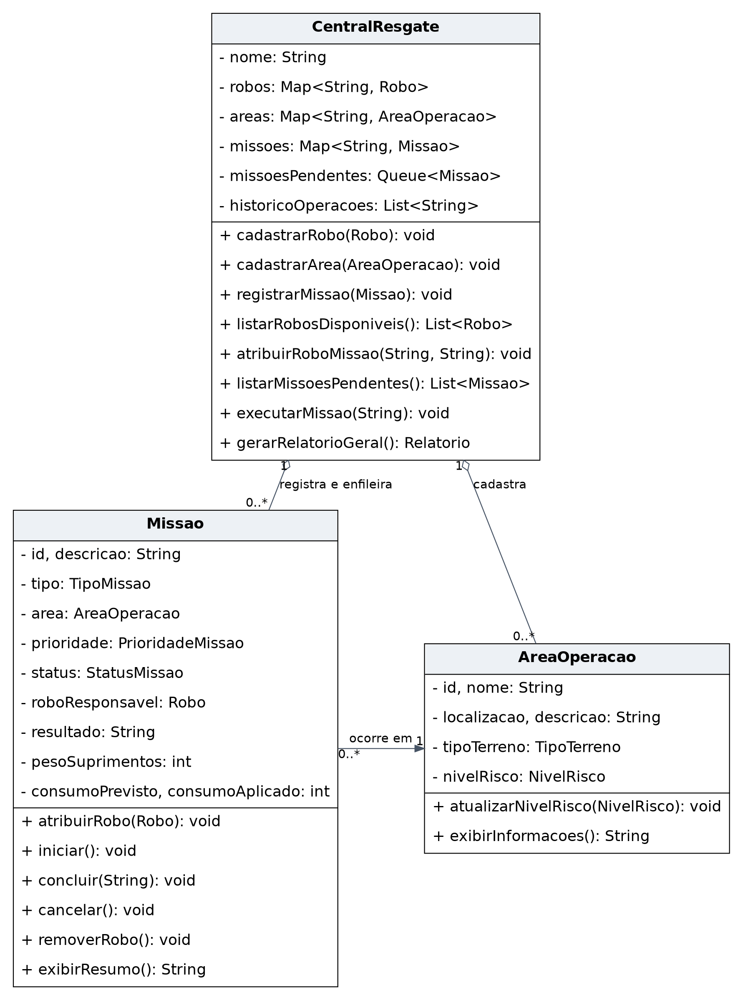
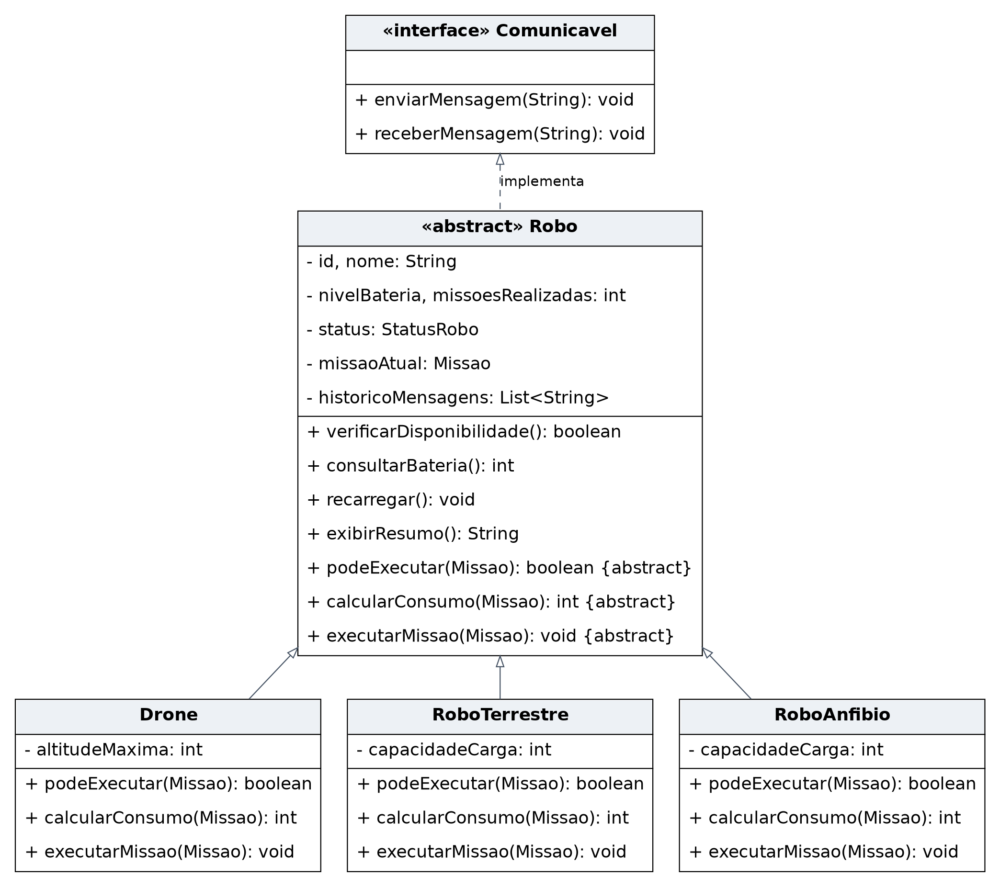
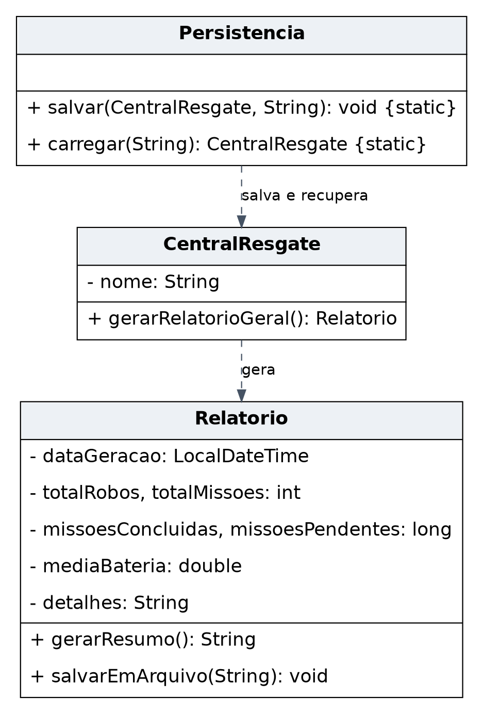
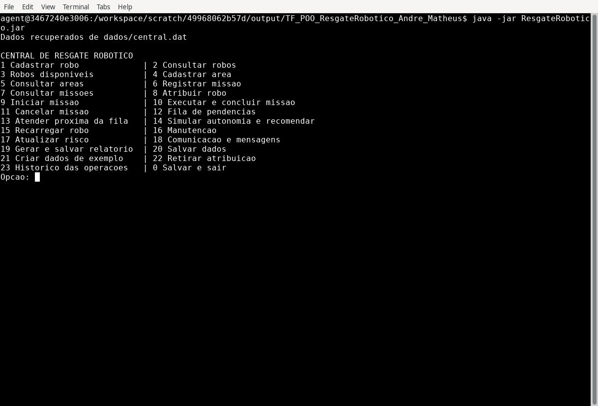
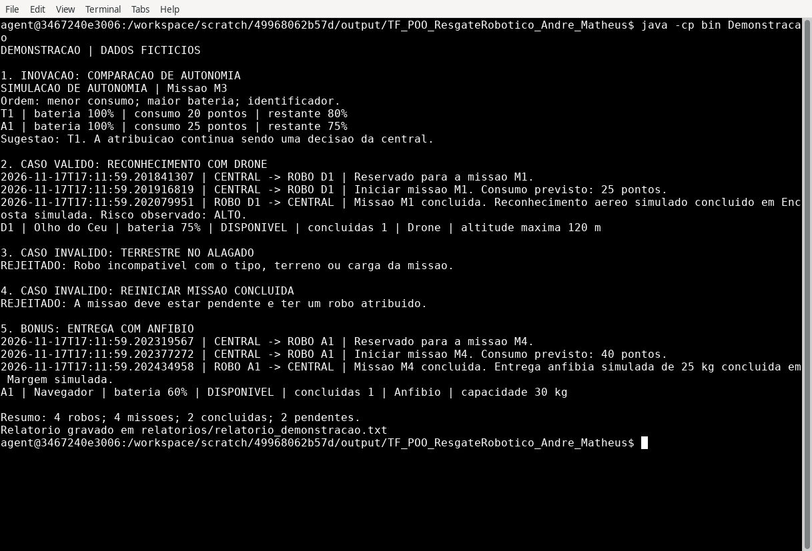
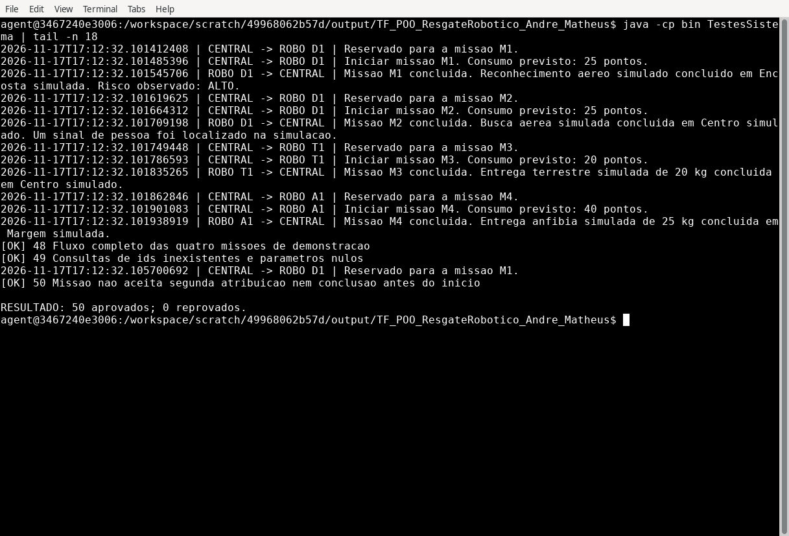

# Sistema de Coordenação de Robôs para Missões de Resgate

Relatório final de Programação Orientada a Objetos 2026/02

Integrante identificado: André Matheus
Data da versão: 17 de novembro de 2026

## Objetivo e resultado

O sistema coordena drones, robôs terrestres e um robô anfíbio em missões fictícias de reconhecimento, localização de pessoas e transporte de suprimentos. A aplicação funciona no console e mantém seus dados entre execuções por serialização.

Esta versão contém os requisitos mínimos, uma inovação de comparação de autonomia e um terceiro tipo de robô como funcionalidade extra. A implementação usa classes e recursos de Java compatíveis com o conteúdo da disciplina até streams e expressões lambda.

| Entrega | Conteúdo |
| --- | --- |
| Código e programa | 21 arquivos Java em src, classes compiladas em bin e JAR executável. |
| Dados de demonstração | Quatro robôs, três áreas e quatro missões pendentes em dados/central.dat. |
| Documentação | Este relatório, UML editável, imagens UML e guia didático. |
| Evidências | 50 testes de regras, seis cenários de console, retomada entre processos e capturas reais. |

## Resultado da verificação

Compilação concluída sem erros ou avisos na configuração normal do compilador. Os 50 testes de regras passaram; os seis cenários do menu passaram; uma missão salva em andamento foi recuperada e concluída em outro processo Java. A descrição e as saídas estão nas páginas de testes e na pasta evidencias.

Ambiente da verificação: Eclipse ECJ 3.40.0 com source e target Java 8, execução em OpenJDK 21 no Linux. Os scripts com javac e jar estão incluídos para uso com o JDK.

# Estrutura e responsabilidades

Os objetos do domínio guardam as regras da operação. A aplicação lê o teclado e chama a central, que mantém os cadastros, o histórico e a fila coerentes.

| Classe | Responsabilidade |
| --- | --- |
| CentralResgate | Cadastrar, consultar, atribuir, iniciar, executar e cancelar missões; manter mapas, fila e histórico. |
| Robo | Guardar identidade, bateria, status, contador, missão atual e mensagens. Definir operações abstratas. |
| Drone | Reconhecimento e localização de pessoas em qualquer terreno da simulação. |
| RoboTerrestre | Transporte em terreno urbano ou irregular, respeitando a capacidade de carga. |
| RoboAnfibio | Transporte no urbano ou alagado, como terceiro tipo de robô. |
| AreaOperacao | Guardar localização, terreno, risco e descrição. Validar atualização do risco. |
| Missao | Guardar a atividade, a área, a prioridade, o responsável, os estados e os resultados. |
| Comunicavel | Definir enviarMensagem e receberMensagem. |
| Relatorio | Calcular indicadores, montar um resumo e gravar um relatório em texto. |
| Persistencia | Salvar e recuperar o conjunto de objetos a partir da central. |
| Aplicacao | Oferecer o menu e tratar entradas e mensagens de erro. |

## Classes de apoio à entrega

DadosExemplo cria os dados fictícios. Demonstracao executa um roteiro repetível. TestesSistema contém os 50 casos e uma interface funcional simples chamada AcaoTeste. TesteRetomada verifica continuidade em dois processos. As seis enumerações representam estados e categorias.

A separação permite estudar as regras sem depender do teclado: os testes chamam a mesma CentralResgate utilizada pelo menu.

# UML da coordenação

O diagrama mostra os principais atributos, métodos e vínculos. O sinal menos identifica atributos privados; o sinal mais identifica métodos públicos. O losango vazio indica agregação.

Uma central mantém vários robôs, áreas e missões. Cada missão aponta para exatamente uma área. O robô responsável é opcional antes da atribuição. O UML completo, incluindo a associação com Robo, está em diagrama_classes.puml.

A área e o robô são referências aos objetos cadastrados. Não são cópias com o mesmo identificador. Assim, a consulta e a operação trabalham com os mesmos objetos.

# UML dos robôs e da comunicação

Robo é abstrata: representa a parte comum e não é instanciada diretamente. Drone, RoboTerrestre e RoboAnfibio herdam seus atributos e operações concretas e implementam as operações abstratas.

A realização de Comunicavel é indicada pela seta tracejada com triângulo vazio. A interface é implementada em Robo e essa implementação é herdada pelas subclasses.

~~~java
Robo robo = missao.getRoboResponsavel();
robo.executarMissao(missao);
~~~

Esse trecho, em CentralResgate, demonstra polimorfismo. A variável tem tipo Robo, mas a implementação escolhida depende do objeto real: reconhecimento aéreo, transporte terrestre ou transporte anfíbio. Não é necessário escolher a subclasse por uma sequência de testes de tipo.

# Coleções e classes de apoio

| Estrutura | Uso e justificativa |
| --- | --- |
| Map<String, Robo> | HashMap: a chave é o id e o valor é o robô. containsKey impede duplicatas; get consulta por identificador. |
| Map<String, AreaOperacao> | HashMap: localiza a área cadastrada e preserva sua referência nas missões. |
| Map<String, Missao> | HashMap: consulta atividades por id e mantém concluídas e canceladas no histórico. |
| Queue<Missao> | LinkedList: mantém as pendentes na ordem de registro. Atribuir não retira; iniciar ou cancelar retira. |
| List<String> | ArrayList: guarda mensagens e registros de operação na ordem em que aconteceram. |
| List<Robo> e List<Missao> | ArrayList e listas coletadas por stream: consultas, filtros e comparação de candidatos. |

As consultas retornam novas listas para evitar que um clear feito pelo chamador apague a coleção interna. Os objetos dentro delas continuam sendo os objetos do domínio, pois a central precisa operar sobre suas referências.

Relatorio representa um retrato do instante de geração. Persistencia concentra a leitura e a escrita do estado completo.

# Compatibilidade e consumo de bateria

| Robô | Missão | Terreno | Condição |
| --- | --- | --- | --- |
| Drone | Reconhecimento ou localização | Todos | Bateria suficiente. Altitude máxima positiva no cadastro. |
| Terrestre | Transporte | Urbano ou irregular | Peso positivo e até a capacidade de carga. |
| Anfíbio | Transporte | Urbano ou alagado | Peso positivo e até a capacidade de carga. |

Reconhecimento e localização têm peso zero. Transporte exige peso inteiro positivo em quilogramas. A altitude do drone é uma característica informativa nesta simulação; não há planejamento de trajetórias ou altitude de missão.

| Operação | Base em pontos percentuais | Adicional |
| --- | --- | --- |
| Drone reconhece | 15 | Risco: baixo 0, médio 5, alto 10. |
| Drone localiza | 25 | Risco: baixo 0, médio 5, alto 10. |
| Terrestre transporta | 20 | Irregular acrescenta 10; somar risco. |
| Anfíbio transporta | 25 | Alagado acrescenta 10; somar risco. |

Bateria final = bateria inicial - consumo previsto. O consumo é uma quantidade de pontos percentuais, não uma porcentagem da bateria que restava. Por exemplo, 100 - 25 = 75.

Atribuição verifica bateria e compatibilidade. O início verifica novamente e fixa a previsão. A conclusão desconta essa previsão uma única vez. Uma alteração posterior no risco não recalcula uma missão que já foi iniciada.

Exemplos conferidos: D1 em M1 consome 15 + 10 = 25 e termina com 75%. T1 em M3 consome 20 e termina com 80%. A1 em M4 consome 25 + 10 + 5 = 40 e termina com 60%.

# Estados e regras da fila

| Ação | Estado da missão | Estado do robô |
| --- | --- | --- |
| Registrar | PENDENTE e entra na fila | Nenhum responsável. |
| Atribuir | Continua PENDENTE | RESERVADO para essa missão. |
| Iniciar | EM_ANDAMENTO e sai da fila | EM_MISSAO. |
| Concluir | CONCLUIDA e recebe resultado | Disponível ou SEM_BATERIA; contador aumenta. |
| Cancelar antes do início | CANCELADA e sai da fila | Reserva liberada; bateria mantida. |
| Cancelar em andamento | CANCELADA | Previsão descontada; contador não aumenta. |
| Retirar atribuição | Continua PENDENTE na fila | Reserva liberada, sem consumo. |

RESERVADO é um valor adicional permitido pelo enunciado. Ele distingue o robô já comprometido com uma missão daquele que ainda está disponível, sem indicar que a execução começou.

O atendimento da fila escolhe a primeira missão ainda sem responsável. Se ela não tiver um candidato, permanece na mesma posição e nenhuma missão é perdida. As que já têm reserva são ignoradas nesse atendimento. A atribuição manual permite selecionar outra missão.

PrioridadeMissao guarda BAIXA, MEDIA ou ALTA para consulta e decisão da central. A fila implementada é FIFO, isto é, respeita a ordem de registro; ela não é uma fila de prioridades.

## Proteções de estado

Não é possível iniciar sem robô, executar duas missões simultâneas com o mesmo robô, recarregar um robô reservado ou em operação, ou reiniciar missões concluídas e canceladas. Manutenção impede atribuição. Recarga durante manutenção preserva EM_MANUTENCAO.

IDs são únicos por categoria e distinguem maiúsculas e minúsculas. A bateria é inteira entre zero e cem. Os construtores validam os dados antes de deixar o objeto disponível para uso.

# Streams lambdas comunicação e arquivos

## Processamento de coleções

~~~java
return listarRobos().stream()
        .filter(r -> r.verificarDisponibilidade())
        .collect(Collectors.toList());
~~~

filter seleciona os robôs que atendem à condição. A lambda recebe um robô r e devolve o resultado de verificarDisponibilidade. collect reúne os selecionados em uma nova lista. É o mesmo encadeamento apresentado nos exemplos da aula.

O relatório usa filter e count para contar estados, mapToInt e sum para totalizar missões realizadas, e average para a bateria média. A média só é acessada quando há robôs, evitando falha em uma central vazia. A ordenação usa List.sort com lambda, também presente nos exemplos.

## Comunicação

Comunicavel exige enviarMensagem(String mensagem) e receberMensagem(String mensagem). Robo registra data e hora, sentido da comunicação e texto no histórico, além de exibir a mensagem no console. A central pode enviar instruções e registrar informações recebidas. Reserva, início e encerramento também produzem mensagens.

## Persistência e relatório em texto

CentralResgate, Robo, AreaOperacao e Missao implementam Serializable; as subclasses herdam essa capacidade. ObjectOutputStream salva a central com seus mapas, fila, mensagens e objetos alcançáveis. ObjectInputStream recupera o conjunto e mantém as referências compartilhadas, inclusive os vínculos de uma missão em andamento.

serialVersionUID identifica a versão de serialização das classes. Não representa criptografia ou formato de relatório. O relatório de operação é gravado separadamente em texto UTF-8 com BufferedWriter, no estilo do material de arquivos.

IOException trata erros de arquivo; ClassNotFoundException trata classe indisponível na recuperação. O menu também trata IllegalArgumentException, IllegalStateException e entradas numéricas inválidas. Um arquivo ilegível no início encerra a abertura com mensagem e não é substituído por uma central vazia.

# Funcionalidade inovadora e bônus

## Comparação de autonomia

A inovação simula o resultado de usar cada robô elegível na mesma missão. Exibe bateria atual, consumo e bateria restante e apresenta uma recomendação. A consulta não altera bateria, responsável nem estados.

A ordenação compara primeiro o menor consumo. Em caso de empate, prefere maior bateria atual. Persistindo o empate, escolhe o menor identificador em ordem de texto. O critério fica visível no console e é determinístico.

| Candidato para M3 | Bateria inicial | Consumo | Restante |
| --- | --- | --- | --- |
| T1 terrestre | 100% | 20 pontos | 80% |
| A1 anfíbio | 100% | 25 pontos | 75% |

A sugestão é T1. O resultado é uma comparação de alternativas além da simples verificação de compatibilidade exigida no mínimo. A opção 14 mostra a comparação; a opção 8 faz a atribuição escolhida pela central. A opção 13 usa a mesma ordenação no atendimento da próxima pendência.

## Terceiro tipo de robô

RoboAnfibio é a funcionalidade extra escolhida entre as opções de bônus. Ele transporta em terreno alagado, que o terrestre não atende, e também em terreno urbano. Possui capacidade própria de carga e regras próprias de consumo.

A inclusão usa a herança e a sobrescrita já estudadas: o novo tipo implementa podeExecutar, calcularConsumo e executarMissao. O fluxo de execução da central permanece o mesmo. O menu e o cadastro permitem criar esse tipo.

Os resultados de reconhecimento, localização e entrega são simulados e repetíveis. Um sinal de pessoa na busca é um resultado fictício, sem relação com uma operação real.

# Testes realizados e resultados

A verificação automatizada foi executada na preparação desta versão com saída real em evidencias/testes_automaticos.txt. Foram aprovados 50 casos. Os exemplos abaixo incluem o mínimo pedido no enunciado e verificações adicionais.

| Caso | Procedimento | Resultado obtido |
| --- | --- | --- |
| Válido T21 | Atribuir D1 a M1 e executar reconhecimento de risco alto. | CONCLUIDA, resultado aéreo, bateria 75%, disponível e contador 1. |
| Inválido T16 | Atribuir T1 à entrega M4 em terreno alagado. | IllegalArgumentException; atribuição rejeitada. |
| Inválido T18 | Drone com 10% tenta missão que exige 25 pontos. | IllegalStateException; continua livre e missão sem robô. |
| Inválido T22 | Iniciar e executar novamente missão concluída. | Operação rejeitada; bateria e contador preservados. |
| Inesperado T29 | Aumentar o risco depois da reserva, antes do início. | Bateria revalidada; início recusado sem perda da pendência. |
| Arquivo T40 | Salvar missão em andamento, recuperar e concluir. | Vínculos, fila, mensagens e desconto de bateria preservados. |
| Arquivo T41 e T43 | Ler bytes corrompidos ou um objeto de outra classe. | IOException tratada; arquivo inválido não vira central. |
| Inovação T33 e T34 | Comparar candidatos e empates e simular bateria. | Critérios corretos; consulta não modifica os objetos. |

Outros casos cobrem cadastros duplicados, campos vazios, carga excessiva, fila FIFO, bateria exatamente zero, manutenção, cancelamentos, cópias de listas, média sem robôs, relatório em arquivo e execução das quatro missões.

## Menu e processos separados

Seis cenários adicionais verificaram: letras no menu e opção inexistente; recuperação e início de missão; conclusão em novo processo; cadastro completo com bateria inválida; fim da entrada; arquivo corrompido preservado. Todos passaram.

TesteRetomada foi executado em dois processos: o primeiro salvou M1 EM_ANDAMENTO com D1 EM_MISSAO; o segundo recuperou e concluiu uma única vez, com bateria final de 75%. As duas transcrições estão em evidencias.

# Captura do menu em funcionamento

Captura real do terminal gráfico executando o JAR entregue. A abertura recuperou dados/central.dat e exibiu todas as opções de operação.

Figura 1. Aplicação aberta no terminal. A consulta de robôs, áreas e missões, a simulação de autonomia, a persistência e a geração do relatório podem ser demonstradas a partir do menu.

Os PNGs originais acompanham o ZIP em evidencias/capturas para consulta em resolução completa. Esta imagem registra o programa em execução; não é uma tela desenhada para substituir a aplicação.

# Captura da simulação e dos erros tratados

Figura 2. Execução real de Demonstracao: comparação de autonomia; reconhecimento com drone; rejeição do terrestre no alagado; rejeição de reinício; transporte com anfíbio.

D1 termina o reconhecimento com 75% e uma missão concluída. A1 termina a entrega com 60%. O resumo informa duas missões concluídas e duas pendentes. O relatório de operação é gravado em relatorios/relatorio_demonstracao.txt.

Demonstracao utiliza uma central própria em memória, permitindo repetir esse roteiro sem alterar o arquivo inicial da aplicação.

# Captura dos testes e evidência de retomada

Figura 3. Trecho final de uma nova execução de TestesSistema no terminal gráfico, com o resultado de 50 aprovados e zero reprovados. A saída completa da execução automatizada acompanha a entrega.

~~~java
PROCESSO 1: salvou M1 EM_ANDAMENTO, D1 EM_MISSAO,
           bateria 100%, fila com 3.
PROCESSO 2: recuperou, concluiu M1 uma vez e obteve
           D1 com bateria 75%. [OK]
~~~

As linhas acima reproduzem os resultados registrados pelos dois processos de TesteRetomada. Os arquivos retomada_gravacao.txt e retomada_recuperacao.txt preservam as transcrições completas.

Os testes foram executados durante a construção desta entrega. Isso não substitui a execução e a compreensão do sistema pelos integrantes para a apresentação individual.

# Uso de inteligência artificial e materiais

## Ferramenta e objetivos

ChatGPT, com o agente Codex, foi utilizado na leitura do enunciado, consulta aos exemplos de aula, definição das regras de simulação, produção do código e documentação, criação dos testes e análise das saídas. Esta versão foi produzida com assistência de IA, e não é apresentada como código desenvolvido sem esse apoio.

## Exemplos dos pedidos utilizados

Pedido de análise: “Bruxo, analisa esse trabalho e faz um levantamento dos pontos importantes”.

Pedido de implementação: “Então resolva o trabalho inteiro. Faça TUDO o que se pede no pdf. Seguindo o padrão do prompt mestre.”

Limitação do pedido: “Lembrando que o conteudo de aula foi apenas ate stream e LAMBDA.” O padrão de estudo fornecido também exige preservar os conceitos e o estilo já estudados e explicar o raciocínio.

## Sugestão de IA alterada nesta versão

Uma versão intermediária da gravação incluía arquivo temporário e Files.move com StandardCopyOption. A revisão retirou essa estratégia e manteve a gravação direta por ObjectOutputStream, para reduzir recursos adicionais e aproximar a solução do estudo de arquivos e serialização. Essa revisão foi feita durante a geração assistida; os integrantes devem confirmá-la ao revisar o projeto.

A correção da alternativa adotada foi verificada com salvamento e recuperação, leitura de arquivo inválido, erro de gravação e retomada em outro processo. A escrita direta não oferece garantia de recuperação após interrupção abrupta durante a gravação; esse limite é aceito nesta simulação acadêmica.

## Reflexão e estudo necessário

A IA ajudou a organizar os requisitos e a construir casos de teste. A preparação individual exige compreender referências entre objetos, escolha das coleções, validação de estados, sobrescrita, serialização e o encadeamento de streams. A equipe deve revisar a solução, repetir os testes e ser capaz de alterá-la sem depender da IA. Não são atribuídas à equipe revisões ou atividades que ainda não foram feitas por seus integrantes.

## Materiais de referência

Enunciado TF_POO_2026_02.pdf; exemplos lambdaexemplos.zip e exemplosLambda.zip; slides Aula-expressoes_lambda.pdf e colecoesvariadas_23.2.pdf; exemplos arquivosObjeto.zip. O projeto utiliza APIs padrão de Java. Os materiais de aula servem de referência e não foram redistribuídos no ZIP.

# Conferência dos requisitos e demonstração

| Requisito do enunciado | Onde foi atendido |
| --- | --- |
| Central e métodos mínimos | CentralResgate.java. |
| Robo abstrata e subclasses | Robo, Drone e RoboTerrestre; extra RoboAnfibio. |
| Área e missão com métodos mínimos | AreaOperacao.java e Missao.java. |
| Três tipos mínimos de missão | TipoMissao e regras de podeExecutar nas subclasses. |
| Interface e mensagens | Comunicavel; implementação e histórico em Robo. |
| Relatório e arquivo | Relatorio.java; opção 19 e pasta relatorios. |
| Enumerações mínimas | StatusRobo, StatusMissao, NivelRisco e TipoTerreno. |
| List Map e Queue | Históricos, cadastros e fila em CentralResgate e Robo. |
| Streams e lambdas | Consultas, relatório e comparação de candidatos. |
| Persistência e recuperação | Persistencia; abertura do programa e opções 20 e 0. |
| Tratamento de erros | Construtores, regras, leitura do menu e operações de arquivo. |
| Inovação obrigatória | Comparação de autonomia e recomendação na opção 14. |
| Funcionalidade extra de bônus | Terceiro tipo RoboAnfibio. |
| UML regras testes capturas e IA | Este relatório, fontes editáveis e pasta evidencias. |

## Roteiro de apresentação

Abrir a aplicação; consultar robôs e áreas; simular M3; atribuir D1 a M1; iniciar e concluir; mostrar bateria e contador; tentar T1 em M4; demonstrar o anfíbio; gerar relatório; salvar e reabrir. Os valores iniciais e a sequência detalhada estão no README.

Para a avaliação individual, explicar uma operação desde o menu até o objeto responsável e justificar cada coleção. Uma alteração simples possível é mudar um consumo ou critério de compatibilidade e ajustar o teste correspondente.

A modalidade exigida é dupla ou trio. O material identifica André Matheus; os demais nomes e o identificador do grupo precisam ser acrescentados conforme a composição real. A data exata segue o cronograma da disciplina. A apresentação e a avaliação individual são atividades dos integrantes.
